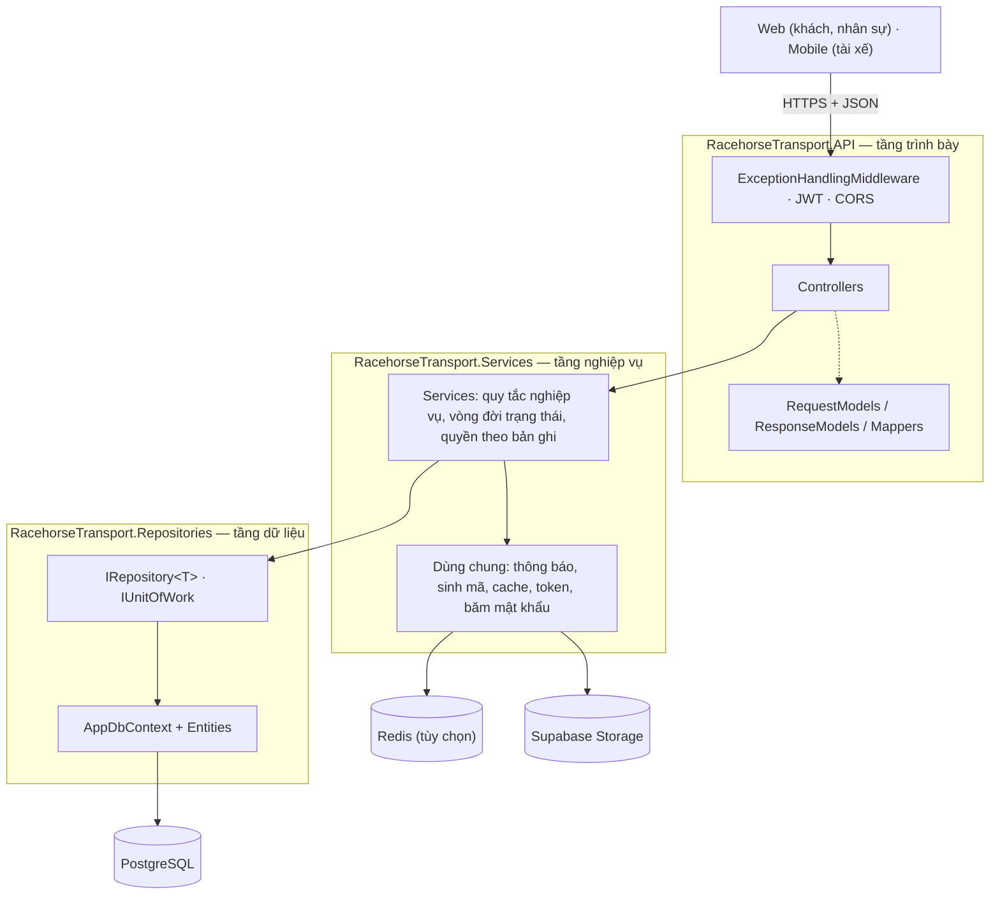

# Racehorse Transport – Backend

Backend của **hệ thống vận chuyển ngựa đua xuyên quốc gia** (Cross-Border Racehorse Transport System) – đồ án SWP391, Group 5.

Hệ thống số hóa toàn bộ quá trình đưa một con ngựa đua từ trang trại ở nước này tới trường đua ở nước khác: khách đặt chuyến, công ty duyệt và làm hồ sơ kiểm dịch – thông quan, lên lộ trình và điều xe, theo dõi thể trạng ngựa trên đường, xử lý sự cố, và bàn giao có ký nhận điện tử.

- [1. Nghiệp vụ](#1-nghiệp-vụ)
- [2. Công nghệ](#2-công-nghệ)
- [3. Kiến trúc](#3-kiến-trúc)
- [4. Chạy dự án](#4-chạy-dự-án)
- [5. Quy ước khi code](#5-quy-ước-khi-code)
- [6. Thêm một chức năng CRUD mới](#6-thêm-một-chức-năng-crud-mới)

| Tài liệu | Nội dung |
|---|---|
| [docs/API.md](docs/API.md) | Hướng dẫn dùng API cho frontend: đăng nhập, quy ước, endpoint theo từng luồng |
| [docs/DEPLOY.md](docs/DEPLOY.md) | Đưa database lên Supabase và API lên Railway |
| [docs/TASKS.md](docs/TASKS.md) | Công việc, phân công, các quyết định nghiệp vụ đã chốt |

Bản đang chạy: https://racehorsetransportbackend-production.up.railway.app/swagger

## 1. Nghiệp vụ

### Người dùng

| Vai trò | Role trong hệ thống | Làm gì |
|---|---|---|
| Khách hàng (CLB / chủ ngựa) | `Customer` | Quản lý ngựa, đặt chuyến, nộp giấy tờ, theo dõi hành trình, ký nhận bàn giao |
| Quản lý điều hành | `LogisticsManager` | Duyệt đơn, chọn chuyên viên phụ trách, duyệt kế hoạch chuyến và chi phí phát sinh, đóng chuyến, xem báo cáo |
| Chuyên viên thủ tục & kiểm dịch | `TransportSpecialist` | Lập hồ sơ số cho từng con ngựa, thẩm định giấy tờ, theo dõi thông quan |
| Điều phối đội xe & lộ trình | `FleetCoordinator` | Quản lý phương tiện, xếp ngựa vào chuyến, lên lộ trình, xử lý sự cố |
| Tài xế / nhân viên áp tải | `DriverEscort` | Cập nhật từng mốc hành trình, ghi nhật ký thể trạng ngựa, báo sự cố, bàn giao (dùng ứng dụng mobile) |
| Quản trị | `Admin` | Quản lý tài khoản và danh mục |

### Sáu luồng chính

| # | Luồng | Tóm tắt |
|---|---|---|
| 1 | Tạo & duyệt yêu cầu vận chuyển | Khách tạo đơn và xem báo giá → Manager duyệt (chọn chuyên viên phụ trách) hoặc từ chối |
| 2 | Hồ sơ pháp lý & kiểm dịch | Chuyên viên yêu cầu giấy tờ theo quy định của nước đi và nước đến → khách nộp → thẩm định → nộp cơ quan chức năng → thông quan |
| 3 | Lộ trình & điều phối phương tiện | Điều phối viên xếp ngựa vào chuyến (xe, tài xế, áp tải, các mốc dừng) → Manager duyệt kế hoạch |
| 4 | Trạng thái & nhật ký lộ trình | Tài xế check-in từng mốc, ghi thể trạng ngựa kèm ảnh → điều phối viên và khách theo dõi |
| 5 | Sự cố & nắn tuyến | Tài xế báo sự cố → điều phối viên đề xuất phương án → Manager duyệt chi phí → áp dụng lộ trình mới |
| 6 | Bàn giao & nghiệm thu | Tới đích → người nhận ký biên bản điện tử (e-POD) → Manager đóng chuyến, hệ thống tính KPI đúng giờ và chi phí |

Hai điểm đáng chú ý của mô hình dữ liệu:

- **Đơn và chuyến là quan hệ nhiều – nhiều.** Một chuyến ghép được ngựa của nhiều đơn; một đơn nhiều ngựa có thể chia ra nhiều chuyến. Bảng nối là `fleet.trip_horses` (từng con ngựa của đơn nằm ở ô chuồng nào của chuyến nào).
- **Mỗi con ngựa trong đơn có một bộ hồ sơ riêng** (`clearance.digital_dossiers`), và chuyến chỉ được xuất phát khi mọi hồ sơ của ngựa trên chuyến đã thông quan.

## 2. Công nghệ

| Thành phần | Lựa chọn |
|---|---|
| Nền tảng | ASP.NET Core 8 Web API (C#) |
| Database | PostgreSQL 15+ (deploy trên Supabase), database-first |
| Truy cập dữ liệu | Entity Framework Core 8 + Npgsql |
| Xác thực | JWT access token + refresh token dùng một lần, mật khẩu băm BCrypt |
| Phân quyền | Theo role (`[Authorize(Roles = ...)]`) và theo từng bản ghi trong tầng Services |
| Cache | Redis (tùy chọn), tự chuyển sang cache trong bộ nhớ khi không cấu hình |
| Lưu file | Supabase Storage |
| Tài liệu API | Swagger / OpenAPI tại `/swagger` |

## 3. Kiến trúc

Ứng dụng chia ba tầng, mỗi tầng một project. Chiều phụ thuộc chỉ đi một hướng: `API → Services → Repositories`.



### Trách nhiệm từng tầng

| Tầng | Được làm | Không được làm |
|---|---|---|
| **API** | Nhận HTTP, kiểm tra định dạng dữ liệu vào (DataAnnotations), kiểm tra role, đổi Request ↔ BusinessModel ↔ Response | Gọi thẳng repository; chứa quy tắc nghiệp vụ |
| **Services** | Mọi quy tắc nghiệp vụ: kiểm tra trạng thái, trùng lặp, quyền sở hữu; điều phối nhiều repository trong một transaction | Biết về HTTP (không dùng `HttpContext`, không trả status code) |
| **Repositories** | Ánh xạ bảng, truy vấn, lưu dữ liệu | Chứa quy tắc nghiệp vụ |

### Đường đi của một request

Ví dụ `POST /api/horses` (khách thêm một con ngựa):

1. `ExceptionHandlingMiddleware` bọc toàn bộ request; JWT middleware đọc token và dựng `User`.
2. `HorsesController.Create` chỉ chạy khi token có role `Customer`. `[ApiController]` tự kiểm tra `CreateHorseRequest`; sai định dạng thì trả 400 ngay.
3. Controller đổi request thành `HorseModel` (mapper chuẩn hóa: cắt khoảng trắng, viết hoa mã microchip) và gọi `IHorseService.CreateHorseAsync(model, User.ToCurrentUser())`.
4. `HorseService` kiểm tra quy tắc (giới tính hợp lệ, ngày sinh trong quá khứ, mã microchip chưa tồn tại), gán chủ ngựa là người đang đăng nhập, rồi lưu qua `IRepository<Horse>`.
5. Kết quả đi ngược lên: Entity → `HorseModel` → `HorseResponse`, bọc trong khuôn `ApiResponse`.
6. Nếu service ném `BusinessException` / `ForbiddenException` / `NotFoundException`, middleware đổi thành 400 / 403 / 404 với cùng khuôn response.

### Cấu trúc thư mục

```
RacehorseTransport.API
  Controllers/                      Mỗi nhóm endpoint một controller
  RequestModels/                    Dữ liệu client gửi lên + DataAnnotations
  ResponseModels/                   Dữ liệu trả về (ApiResponse là khuôn chung)
  Mappers/                          Request -> BusinessModel -> Response
  Middlewares/                      ExceptionHandlingMiddleware
  Extensions/                       ServiceCollectionExtensions: đăng ký DI, JWT, CORS, Swagger, cache
  Helpers/                          User.GetUserId(), User.ToCurrentUser()

RacehorseTransport.Services
  Interfaces/ Implementations/      IXxxService + XxxService
  BusinessModels/                   Model trao đổi giữa API và Services
  Mappers/                          Entity <-> BusinessModel
  Exceptions/                       BusinessException, NotFoundException, ForbiddenException, UnauthorizedException
  Extensions/                       ApplySort, ToPagedResultAsync
  Constants/                        CacheKeys, CodePrefixes
  Options/                          JwtOptions

RacehorseTransport.Repositories
  Entities/                         Entity khớp từng bảng
  Context/AppDbContext.cs           Ánh xạ bảng / schema / khóa ngoại
  Interfaces/ Implementations/      IRepository<T>, IUnitOfWork, ICodeCounterRepository
  Constants/DomainConstants.cs      Role và mọi giá trị trạng thái (khớp CHECK constraint trong DB)

database/                           Script SQL: nguồn chuẩn duy nhất của schema
docs/TASKS.md                       Công việc, quyết định đã chốt, công thức báo giá và KPI
```

### Database

Schema do các script trong `database/` quản lý (database-first, **không dùng EF Migrations**). Dữ liệu chia theo 10 schema tương ứng các mảng nghiệp vụ:

| Schema | Nội dung | Bảng |
|---|---|---|
| `identity` | Tài khoản | `users` |
| `racehorse` | Hồ sơ ngựa | `horses` |
| `booking` | Yêu cầu vận chuyển | `booking_requests`, `booking_horses` |
| `clearance` | Giấy tờ, kiểm dịch, thông quan | `document_types`, `country_doc_requirements`, `digital_dossiers`, `dossier_documents` |
| `fleet` | Phương tiện, chuyến, lộ trình | `transport_assets`, `trips`, `trip_crew`, `trip_horses`, `route_checkpoints` |
| `tracking` | Nhật ký thể trạng ngựa | `horse_welfare_logs` |
| `incident` | Sự cố | `trip_incidents` |
| `acceptance` | Biên bản bàn giao e-POD | `handover_acceptances` |
| `pricing` | Bảng giá | `price_items` |
| `common` | Thông báo, bộ đếm sinh mã | `system_notifications`, `code_counters` |

Một số lựa chọn thiết kế:

- **Tên theo chuẩn PostgreSQL**: `snake_case` trong DB (`booking_requests.booking_id`), PascalCase trong C# (`BookingId`), camelCase trong JSON (`bookingId`). Việc chuyển đổi là tự động.
- **Ràng buộc nằm trong DB** (khóa ngoại, `UNIQUE`, `CHECK` cho mọi cột trạng thái); **công thức nghiệp vụ nằm trong C#** (báo giá, chốt KPI). Không dùng stored procedure.
- **Thời gian lưu dạng `timestamptz` (UTC)**: API nhận giờ ở múi giờ bất kỳ, trả về giờ UTC, client tự đổi sang giờ địa phương.
- **Schema tên `identity` thay vì `auth`** vì Supabase đã dùng `auth` cho hệ thống riêng của nó.
- **Mã nghiệp vụ** (`BKG-2026-0001`, `TRP-…`) sinh từ bảng đếm bằng một lệnh UPSERT, nên hai request đồng thời không thể nhận trùng mã.

## 4. Chạy dự án

Cần có: .NET SDK 8 và PostgreSQL 15 trở lên (cài trên máy, hoặc chạy bằng Docker, hoặc dùng Supabase).

**Bước 1 – Tạo database.** Các script nằm trong `database/`:

| Script | Nội dung |
|---|---|
| `01_schema.sql` | 10 schema, 19 bảng, toàn bộ ràng buộc |
| `02_seed.sql` | Danh mục, bảng giá, 6 tài khoản dev, một kịch bản đã chạy trọn 6 luồng |
| `00_reset.sql` | (Tùy chọn) Xóa sạch để dựng lại: chạy `00` → `01` → `02` |

Chọn một trong ba cách:

- **PostgreSQL cài trên máy**: mở pgAdmin, tạo database `racehorse_transport`, mở Query Tool rồi chạy `01_schema.sql`, sau đó `02_seed.sql`.
- **Docker**: `docker compose up -d postgres` — tự tạo database và chạy cả hai script (cổng 5433, tài khoản ghi trong `docker-compose.yml`).
- **Supabase**: tạo project, vào **SQL Editor**, dán và chạy `01_schema.sql` rồi `02_seed.sql`.

**Bước 2 – Cấu hình kết nối.** Copy `RacehorseTransport.API/appsettings.Local.example.json` thành `appsettings.Local.json` (file này nằm trong `.gitignore`, không bị commit) rồi điền chuỗi kết nối:

```json
{
  "ConnectionStrings": {
    "DefaultConnection": "Host=localhost;Port=5432;Database=racehorse_transport;Username=postgres;Password=<mật khẩu của bạn>"
  }
}
```

**Đổi qua lại giữa database ở máy và Supabase.** `appsettings.Local.json` giữ cả hai chuỗi kết nối (`Local`, `Supabase`); dòng `"Database": { "Use": "Local" }` chọn chuỗi nào được dùng. Đổi thành `"Supabase"` rồi chạy lại, hoặc chọn tạm cho một lần chạy: `dotnet run --project RacehorseTransport.API -- --Database:Use Supabase`. Dòng log `Database: ...` lúc khởi động cho biết đang nối vào đâu.

Lưu file cần thêm section `Supabase` (`Url`, `ServiceKey`, `Bucket`) trong cùng file; xem `appsettings.Local.example.json`. Chưa điền thì mọi thứ vẫn chạy, chỉ riêng upload file báo lỗi.

Với Supabase: bấm **Connect** trên dashboard, lấy thông số ở mục **Session pooler** (host, port, user dạng `postgres.<mã project>`), database là `postgres`, thêm `SSL Mode=Require`. Không dùng mục *Direct connection*: gói miễn phí chỉ cấp địa chỉ IPv6 cho mục đó, phần lớn mạng ở nhà không kết nối được.

**Bước 3 – Chạy.**

```bash
dotnet run --project RacehorseTransport.API
```

Mở http://localhost:5080/swagger. Đăng nhập bằng `POST /api/auth/login`, copy `accessToken`, bấm **Authorize** và dán vào.

Tài khoản seed (mật khẩu chung ghi ở đầu file `database/02_seed.sql`):

| Email | Role |
|---|---|
| `admin@logistics.com` | Admin |
| `bao.tran@logistics.com` | LogisticsManager |
| `mai.nguyen@clearance.com` | TransportSpecialist |
| `nam.le@fleet.com` | FleetCoordinator |
| `duc.pham@transport.com` | DriverEscort |
| `jane.smith@racehorseowner.com` | Customer |

> Các tài khoản seed và khóa JWT trong `appsettings.Development.json` chỉ dành cho môi trường dev. Trên bản deploy phải đổi mật khẩu các tài khoản này và đặt khóa JWT riêng qua biến môi trường `Jwt__Key`.

**Redis (tùy chọn).** Để trống `ConnectionStrings:Redis` thì API dùng cache trong bộ nhớ, đủ để phát triển. Muốn dùng Redis: `docker compose up -d redis` rồi đặt `"Redis": "localhost:6379"` trong `appsettings.Local.json`. Khi dùng cache trong bộ nhớ, refresh token mất mỗi lần khởi động lại API (phải đăng nhập lại).

## 5. Quy ước khi code

**Response.** Mọi endpoint trả về cùng một khuôn:

```json
{ "success": true, "message": "...", "data": { }, "errors": null }
```

Danh sách có thêm `pagination: { page, pageSize, totalItems, totalPages }`. Tên trường JSON là camelCase. Ngày giờ theo ISO 8601 có múi giờ (`2026-10-01T06:00:00+07:00`).

**Tham số danh sách.** `?search=&sort=name,-createdAt&page=1&size=10` (dấu `-` là giảm dần, `size` tối đa 100).

**Báo lỗi.** Service ném exception, controller **không** viết `try/catch`:

| Exception | HTTP | Khi nào |
|---|---|---|
| `BusinessException` | 400 | Sai quy tắc nghiệp vụ, sai trạng thái, trùng mã |
| `UnauthorizedException` | 401 | Sai thông tin đăng nhập, token hết hạn |
| `ForbiddenException` | 403 | Không có quyền trên dữ liệu này (vd: khách xem ngựa của người khác) |
| `NotFoundException` | 404 | Không tìm thấy |

Lỗi validation của RequestModel tự trả 400 kèm danh sách lỗi, không cần kiểm tra `ModelState`.

**Phân quyền.** `[Authorize]` cho mọi endpoint cần đăng nhập; siết theo role bằng `[Authorize(Roles = UserRoles.LogisticsManager)]`. Nhiều `[Authorize]` chồng nhau (class + action) phải thỏa **tất cả**, nên khi các action cần role khác nhau thì đặt role ở từng action. Quyền theo từng bản ghi (vd: khách chỉ sửa ngựa của mình) kiểm tra trong service, bằng `CurrentUser` lấy từ `User.ToCurrentUser()`.

**File.** Request nghiệp vụ có file (ảnh ngựa, giấy tờ hồ sơ, ảnh nhật ký) nhận `multipart/form-data` với `[FromForm]` và một trường `IFormFile`. Controller đổi file thành `FileUploadModel` (`request.Photo.ToUploadModel()`) rồi truyền xuống service; service kiểm tra nghiệp vụ xong mới gọi `IFileStorageService.UploadAsync`, để request sai không để lại file rác. DB chỉ lưu `path` (không lưu URL), vì bucket để riêng tư và link xem có thời hạn. Trước khi trả model ra ngoài, service đổi `path` thành link xem bằng `_fileStorage.ResolveViewUrlsAsync(models, m => m.PhotoUrl, (m, url) => m.PhotoUrl = url)`: cả danh sách chỉ tốn một lần gọi storage và link được cache. `FilesController` (upload riêng một file, cấp link cho một `path`) vẫn còn trong code nhưng đang ẩn khỏi Swagger vì chưa có chỗ nào dùng.

**Trạng thái.** Dùng hằng số trong `DomainConstants.cs` (`BookingStatuses.Approved`), không gõ chuỗi trực tiếp.

**Ghi nhiều bảng trong một nghiệp vụ.** Bọc trong `IUnitOfWork.ExecuteInTransactionAsync(...)`.

**Database.** Đổi schema = sửa script SQL trước, rồi sửa entity và `AppDbContext`. Tên cột `snake_case` tự suy ra từ tên property, không cần `HasColumnName`.

**Tìm kiếm chuỗi.** PostgreSQL phân biệt hoa thường, nên khi tìm kiếm phải đưa hai vế về chữ thường: `x.Name.ToLower().Contains(search.ToLower())` (xem `DocumentTypeService`).

**Git.** Mỗi task một nhánh `feature/<mã task>-<mô tả>` (vd `feature/B-01-transport-assets`), mở Pull Request vào `main`, người còn lại review rồi mới merge. Mỗi chức năng có file Mapper/Request/Response riêng nên hai người hiếm khi sửa chung file; chỗ chung duy nhất là thêm một dòng đăng ký service trong `ServiceCollectionExtensions.AddBusinessServices`.

## 6. Thêm một chức năng CRUD mới

Lấy **DocumentTypes** làm mẫu, copy rồi đổi tên. Thứ tự làm từ dưới lên:

| # | File cần tạo | Mẫu để copy |
|---|---|---|
| 1 | `Services/BusinessModels/XxxModel.cs` | `DocumentTypeModel.cs` |
| 2 | `Services/Mappers/XxxMapper.cs` | `DocumentTypeMapper.cs` |
| 3 | `Services/Interfaces/IXxxService.cs` | `IDocumentTypeService.cs` |
| 4 | `Services/Implementations/XxxService.cs` | `DocumentTypeService.cs` |
| 5 | `API/RequestModels/XxxRequests.cs` | `DocumentTypeRequests.cs` |
| 6 | `API/ResponseModels/XxxResponse.cs` | `DocumentTypeResponse.cs` |
| 7 | `API/Mappers/XxxApiMapper.cs` | `DocumentTypeApiMapper.cs` |
| 8 | `API/Controllers/XxxController.cs` | `DocumentTypesController.cs` |
| 9 | Thêm 1 dòng `services.AddScoped<IXxxService, XxxService>();` | `ServiceCollectionExtensions.AddBusinessServices` |
| 10 | Thêm các request thử vào `RacehorseTransport.API.http` | phần "Document types" |

Entity và `DbSet` của mọi bảng đã có sẵn, không cần tạo thêm. Cần ví dụ có kiểm tra quyền theo từng bản ghi thì xem `HorseService` và `HorsesController`.
