# Luồng nghiệp vụ hệ thống vận chuyển ngựa đua

Tài liệu này mô tả cách hệ thống chạy từ lúc khách khai báo ngựa đến khi bàn giao, đóng chuyến và xử lý các trường hợp phát sinh. Chi tiết request/response của từng endpoint xem trong `docs/API.md`; quy tắc tiền và thời hạn xem trong `docs/CHINH_SACH_DICH_VU.md`.

## 1. Vai trò tham gia

| Vai trò | Mã role | Trách nhiệm chính |
|---|---|---|
| Khách hàng | `Customer` | Quản lý ngựa, tạo đơn, chấp nhận báo giá/hợp đồng, thanh toán, nộp giấy, theo dõi và quyết định khi phát sinh |
| Quản lý điều hành | `LogisticsManager` | Duyệt đơn, tuyến, chuyến, phương án sự cố, bồi thường và đóng chuyến |
| Chuyên viên kiểm dịch | `TransportSpecialist` | Yêu cầu, thẩm định và xử lý hồ sơ kiểm dịch |
| Điều phối đội xe | `FleetCoordinator` | Lập tuyến, xếp chuyến, chọn xe/crew, đề xuất xử lý sự cố |
| Tài xế/áp tải | `DriverEscort` | Chạy chuyến, cập nhật checkpoint, thể trạng, báo sự cố và bàn giao |
| Quản trị viên | `Admin` | Quản lý tài khoản/danh mục và có quyền hỗ trợ các nghiệp vụ quản trị |

## 2. Sơ đồ tổng thể

```mermaid
flowchart LR
    A[Khách quản lý hồ sơ ngựa] --> B[Tạo đơn và nhận khoảng giá]
    B --> C[Manager duyệt sơ bộ]
    C --> D[Coordinator lập tuyến]
    D --> E[Manager duyệt tuyến]
    E --> F[Báo giá chốt và hợp đồng nháp]
    F --> G[Khách chấp nhận và đặt cọc]
    G --> H[Hồ sơ kiểm dịch từng con]
    H --> I[Coordinator xếp chuyến]
    I --> J[Manager duyệt chuyến]
    J --> K[Kiểm tra trước xuất phát]
    K --> L[Chạy chuyến và theo dõi]
    L --> M{Có sự cố?}
    M -- Có --> N[Báo sự cố, đề xuất, duyệt, xử lý]
    N --> L
    M -- Không / đã xử lý --> O[Bàn giao e-POD]
    O --> P[Đóng chuyến, KPI, phát sinh]
    P --> Q[Thanh toán hoặc bồi thường còn lại]
```

Luồng trên là luồng chuẩn cho vận chuyển đường bộ. Đơn đường hàng không bỏ qua bước lập tuyến mặt đất của đơn: sau khi Manager duyệt sơ bộ, hệ thống có thể phát hành báo giá chốt theo tuyến bay và bảng giá quốc gia.

---

## 3. Luồng 0 — Tài khoản và hồ sơ ngựa

### Người thực hiện

`Customer`.

### Các bước

1. Khách đăng ký hoặc đăng nhập.
2. Khách tạo hồ sơ từng con ngựa: tên, giống, giới tính, ngày sinh, màu, microchip, hộ chiếu và yêu cầu chăm sóc.
3. Khách có thể tải ảnh và hồ sơ thú y dùng lại như hộ chiếu, tiêm phòng, xét nghiệm.
4. Hệ thống kiểm tra quyền sở hữu: khách chỉ sửa/xóa/xem tài liệu riêng của ngựa mình.

### Endpoint chính

- `POST /api/auth/register`, `POST /api/auth/login`.
- `GET/POST/PUT/DELETE /api/horses...`.
- `GET/POST/DELETE /api/horses/{id}/documents...`.
- `POST /api/files` để tải chứng từ trước khi gắn path vào request JSON.

---

## 4. Luồng 1 — Tạo đơn, lập tuyến, báo giá và hợp đồng

### 4.1. Khách xem phạm vi dịch vụ và khoảng giá

1. Frontend lấy danh sách quốc gia/phương thức/sân bay từ `GET /api/countries/catalog`.
2. Khách chọn điểm đón, điểm giao và tọa độ từ bản đồ.
3. Khách chọn ngựa, hạng chuồng, yêu cầu điều hòa, gói bảo hiểm và khai giá trị từng con.
4. `POST /api/bookings/quote-preview` trả **khoảng giá ước tính**, chưa phải giá chốt.
5. Với đường bộ, có thể gọi `POST /api/bookings/estimate-distance` hoặc API bản đồ để lấy quãng đường.

### 4.2. Khách gửi đơn

`POST /api/bookings` kiểm tra:

- Ngựa thuộc khách và còn hoạt động.
- Tuổi, tình trạng sinh sản và điều kiện vận chuyển.
- Điểm đi/đến và phương thức nằm trong phạm vi công ty nhận.
- Khoảng ngày đón và hạn giao hợp lệ.
- Giá trị, chứng từ và gói bảo hiểm từng con hợp lệ.
- Thông tin người nhận hợp lệ.
- Khách đã đồng ý đúng phiên bản chính sách hiện hành.

Đơn được tạo với trạng thái:

`Submitted` — chờ Manager xem xét.

### 4.3. Manager duyệt sơ bộ

- Duyệt: `POST /api/bookings/{id}/approve`, chọn Specialist phụ trách.
- Từ chối: `POST /api/bookings/{id}/reject`, ghi lý do.

Đơn đường bộ sau khi duyệt:

`Submitted → PreApproved`.

Đơn đường hàng không có thể được phát hành báo giá chốt ngay sau bước duyệt nếu đủ dữ liệu:

`Submitted → Quoted`.

### 4.4. Coordinator lập tuyến đường bộ

1. Xem trước: `POST /api/bookings/{bookingId}/route-plans/preview`.
2. Tạo nháp: `POST /api/bookings/{bookingId}/route-plans`.
3. Sửa nếu cần: `PUT /api/route-plans/{id}`.
4. Trình Manager: `POST /api/route-plans/{id}/submit`.
5. Manager có thể xem trước giá chốt: `GET /api/route-plans/{id}/quote-preview`.
6. Manager duyệt hoặc từ chối tuyến.

Trạng thái tuyến:

`Draft → Submitted → Approved` hoặc `Rejected → Draft → Submitted`.

Mỗi đơn chỉ có một tuyến `Approved` hiệu lực; tuyến cũ chuyển `Superseded` khi bản mới được duyệt.

### 4.5. Phát hành báo giá chốt và hợp đồng

Khi tuyến được duyệt:

1. Hệ thống tính lại giá theo quãng đường thật, nước quá cảnh, hạng chuồng, phụ phí, bảo hiểm và chiết khấu.
2. Đơn chuyển qua `RoutePlanned` và được phát hành thành `Quoted`.
3. Lưu `quotedAt`, `quoteExpiresAt`, chi tiết `quoteBreakdown`.
4. Sinh hợp đồng PDF trạng thái `Draft`, kèm SHA-256 và phiên bản chính sách.
5. Gửi thông báo/email `QuoteReady` cho khách.

### 4.6. Khách chấp nhận hoặc từ chối

- Chấp nhận: `POST /api/bookings/{id}/accept-quote`, gửi `contractId`, SHA-256, xác nhận chính sách và phiên bản.
- Từ chối: `POST /api/bookings/{id}/decline-quote`.
- Quá hạn: job chuyển đơn sang `QuoteExpired` và gửi email.

Khi chấp nhận thành công:

- Hợp đồng `Draft → Accepted`.
- Lưu người chấp nhận, thời điểm, IP, User-Agent và phiên bản chính sách.
- Đơn `Quoted → AwaitingDeposit`.

### 4.7. Khách đặt cọc

1. `POST /api/bookings/{id}/payments` với `paymentType = Deposit`.
2. Hệ thống trả URL VNPay hoặc mock gateway.
3. Gateway callback xác nhận giao dịch.
4. Thanh toán `Pending → Succeeded`.
5. Khi đủ cọc, đơn `AwaitingDeposit → Approved`.

Đơn chỉ bắt đầu làm hồ sơ và được xếp chuyến sau khi cọc thành công.

---

## 5. Luồng 2 — Hồ sơ kiểm dịch từng con ngựa

### Nguyên tắc

- Mỗi `booking_horse` có một `digital_dossier` riêng.
- Checklist phụ thuộc nước xuất phát, nước đến và các nước quá cảnh.
- Giấy có `providedBy = Customer` do khách nộp; giấy `Company` do Specialist xử lý.

### Các bước

1. Sau khi đơn được kích hoạt, hệ thống có hồ sơ cho từng con.
2. Specialist gọi `POST /api/dossiers/{id}/request-documents` để yêu cầu giấy còn thiếu.
3. Khách/Specialist nộp giấy qua `POST /api/dossiers/{id}/documents`.
4. Specialist duyệt hoặc từ chối từng giấy.
5. Đủ checklist thì hồ sơ được nộp cơ quan chức năng.
6. Specialist ghi nhận thông quan hoặc báo vấn đề.

Trạng thái hồ sơ:

`Draft → AwaitingDocs → Reviewing → SubmittedToAuthorities → Cleared`.

Nhánh lỗi có thể sang `Issue`; giấy riêng lẻ có `Pending → Approved/Rejected`.

Hệ thống có deadline nộp giấy, email nhắc và cơ chế hủy/hoàn theo chính sách nếu khách không hoàn tất đúng hạn.

---

## 6. Luồng 3 — Xếp chuyến và duyệt kế hoạch

### Điều kiện đầu vào

- Đơn đã cọc và đang `Approved`.
- Ngựa chưa nằm trên một chuyến đang hoạt động khác.
- Tuyến và thông tin vận chuyển phù hợp.

### Các bước

1. Coordinator xem hàng chờ: `GET /api/trips/unplanned-horses`.
2. Có thể gọi `POST /api/trips/suggest-route` để gợi ý ghép đơn.
3. Chọn xe và crew đang rảnh.
4. Tạo chuyến nháp bằng `POST /api/trips`.
5. Nếu chuyến một đơn chưa có mốc, hệ thống chép checkpoint từ tuyến `Approved` của đơn.
6. Coordinator chỉnh checkpoint, crew và vị trí chuồng.
7. `POST /api/trips/{id}/submit` để trình Manager.
8. Manager duyệt hoặc trả lại kế hoạch.

Trạng thái chuyến:

`Draft → PendingApproval → Scheduled`.

### Quy tắc quan trọng

- Không được đi qua quốc gia nằm ngoài tuyến đã duyệt/giấy tờ của bất kỳ đơn nào trên chuyến.
- Nếu thời gian lái dự kiến vượt giới hạn một tài xế thì phải có ít nhất hai `Driver`.
- Xe phải đủ sức chứa, đúng điều kiện khí hậu và không trùng lịch.
- Crew không được trùng lịch; phải đủ tài xế và Escort theo số ngựa.
- Manager duyệt chuyến xong, khách/người nhận/crew nhận thông báo phù hợp.

---

## 7. Luồng 4 — Kiểm tra trước xuất phát và chạy chuyến

### 7.1. Thanh toán phần còn lại

Khách trả `Balance` trước ngày xuất phát theo cấu hình. Có thể thanh toán qua VNPay/mock hoặc Manager ghi nhận thủ công.

### 7.2. Departure check

`GET /api/trips/{id}/departure-check` và `POST /api/trips/{id}/start` cùng kiểm tra tại thời điểm gọi:

1. Hồ sơ mọi ngựa đã `Cleared`.
2. Giấy còn hiệu lực tại thời điểm cần dùng.
3. Có giấy khám đủ sức khỏe trong cửa sổ quy định trước khi đi.
4. Các đơn đã trả đủ phần còn lại.
5. Đủ số tài xế cho thời gian lái dự kiến.

Nếu có nhiều lỗi, API trả danh sách đầy đủ để nhân sự xử lý một lần.

### 7.3. Bắt đầu và cập nhật hành trình

Khi start thành công:

- Chuyến `Scheduled → InTransit`.
- Ngựa tương ứng chuyển `Planned → InTransit`.
- Ghi thời điểm lên xe.
- Khách và người nhận được thông báo ETA.

Trong hành trình:

- `POST /api/checkpoints/{id}/arrive`: tới mốc.
- `POST /api/checkpoints/{id}/clear`: thông quan cửa khẩu.
- `POST /api/checkpoints/{id}/depart`: rời mốc.
- `POST /api/trips/{id}/welfare-logs`: ghi nhiệt độ, nước, thức ăn, stress, ghi chú và ảnh.
- Khách theo dõi đơn; Manager/Coordinator theo dõi các chuyến đang chạy.

---

## 8. Luồng 5 — Xử lý sự cố

### Quy trình chung

1. Driver/Escort báo sự cố: `POST /api/trips/{tripId}/incidents`.
2. Sự cố ở trạng thái `Reported`.
3. Coordinator đề xuất phương án: `POST /api/incidents/{id}/propose`.
4. Sự cố chuyển `PlanProposed`.
5. Manager duyệt hoặc từ chối.
6. Coordinator áp dụng phương án cần thao tác tiếp như nắn tuyến.
7. Khi xử lý xong, Coordinator đóng sự cố và chọn `faultParty`.

Trạng thái chính:

`Reported → PlanProposed → Approved → Resolved`.

Nhánh từ chối:

`PlanProposed → Rejected → PlanProposed`.

Đi đường vòng phát sinh tiền có thể chuyển sang `AwaitingConsent` để chờ khách đồng ý.

### Các phương án chính

| Hành động | Ý nghĩa |
|---|---|
| `WaitAndContinue` | Chờ rồi tiếp tục |
| `RepairAndContinue` | Sửa tại chỗ rồi tiếp tục |
| `Reroute` | Đổi tuyến/checkpoint |
| `VeterinaryCare` | Chăm sóc thú y |
| `OffloadHorse` | Dỡ ngựa qua sự cố, chọn hướng xử lý tiếp |
| `ReplaceVehicle` | Thay xe đủ điều kiện |
| `ReplaceCrew` | Thay tài xế hoặc Escort |
| `ReturnToOrigin` | Quay về nơi đi |
| `HoldAtStable` | Gửi ngựa tại chuồng tạm |

### Thay xe

- Xe mới phải `Available`, không trùng lịch, đủ chuồng và đủ điều kiện khí hậu.
- Manager duyệt xong: xe cũ `Maintenance`, xe mới `InTransit`, chuyến dùng xe mới.

### Thay crew

- Người mới phải là `DriverEscort`, còn hoạt động và không trùng lịch.
- Nếu thay Escort, hệ thống chuyển các ngựa người cũ phụ trách cho người mới.

### Xác định bên chịu chi phí

Khi đóng sự cố phải chọn:

- `Company`: công ty chịu chi phí, có thể phát sinh bồi thường giao trễ.
- `Customer`: khách chịu chi phí phát sinh theo chính sách.
- `ForceMajeure`: xử lý hoàn/chi phí theo phần dịch vụ chưa thực hiện và chính sách bất khả kháng.

---

## 9. Luồng bảo hiểm và hồ sơ bồi thường

### Khi nào có claim

- Ngựa chết hoặc phải an tử hợp lệ.
- Ngựa bị thương, có chi phí thú y.
- Ngựa mất, thất lạc hoặc giao nhầm.
- Có thể tự mở từ sự cố/e-POD hoặc khách mở trong thời hạn chính sách.

### Các bước

1. Hồ sơ được tạo ở `Open`.
2. Khách/nhân sự bổ sung bằng chứng.
3. Manager chuyển sang `UnderReview`.
4. Manager duyệt số tiền hoặc từ chối có lý do.
5. Khi chi trả hoàn tất, hồ sơ chuyển `Paid`.

Trạng thái:

`Open → UnderReview → Approved → Paid`, hoặc `UnderReview → Rejected`.

Giao trễ không thuộc bảo hiểm; giao trễ dùng luồng bồi thường riêng.

---

## 10. Luồng 6 — Bàn giao và trường hợp không giao được

### 10.1. Bàn giao thành công

1. Xe tới `DropOff` hoặc `Destination`.
2. Ứng dụng đoàn xe hiển thị người nhận của từng đơn.
3. Driver đối chiếu tên/giấy tờ người nhận.
4. Nếu người ký khác người nhận đã khai, khách phải duyệt người nhận thay thế.
5. Driver tạo e-POD tại `POST /api/trips/{tripId}/handover`:
   - Người nhận.
   - Chữ ký điện tử.
   - Tình trạng ngựa.
   - Ghi chú/ảnh cần thiết.
6. Ngựa chuyển `Delivered`; khách nhận thông báo/email bàn giao.

### 10.2. Không giao được

Driver gọi:

`POST /api/trips/{tripId}/bookings/{bookingId}/delivery-failed`.

Lý do:

- `RecipientAbsent`: người nhận vắng mặt.
- `RecipientRefused`: người nhận từ chối không có lý do thuộc lỗi công ty.
- `RefusedInjured`: từ chối vì ngựa bị thương.
- `RefusedWrongHorse`: từ chối vì giao nhầm ngựa.

Hệ thống lưu ảnh, ghi chú, thời gian chờ và phí chờ. Phí được tính từ lúc check-in sau khi trừ thời gian miễn phí, làm tròn và giới hạn theo cấu hình.

### 10.3. Khách chọn cách xử lý

Với lỗi người nhận, khách gọi `POST /api/bookings/{id}/delivery-decision` và chọn:

1. `AlternateRecipient`: giao cho người/địa chỉ khác.
2. `HoldAtStable`: gửi chuồng tạm.
3. `ReturnToOrigin`: chở về nơi đi.

Quá hạn quyết định, hệ thống mặc định `HoldAtStable`. Chi phí hợp lệ được cộng vào khoản `Extra`.

Nếu từ chối vì ngựa bị thương hoặc giao nhầm, hệ thống mở sự cố/claim và công ty chịu chi phí theo kết quả xác định lỗi.

---

## 11. Đóng chuyến, KPI và dòng tiền cuối

### Đóng chuyến

Manager gọi `POST /api/trips/{tripId}/close` sau khi các ngựa đã được bàn giao hoặc có hướng xử lý hợp lệ.

Hệ thống:

- Ghi thời gian kết thúc thực tế.
- Tính số phút/giờ trễ và KPI.
- Tổng hợp chi phí sự cố, phí chờ, chuồng tạm và các khoản phát sinh.
- Xác định đơn hoàn tất hay còn tiền phải trả.

Trạng thái chuyến:

`ArrivedDestination → Completed`.

Trạng thái đơn:

- Không còn khoản phải trả: `Completed`.
- Còn phát sinh: `AwaitingFinalPayment → Completed` sau khi trả đủ.

### Bồi thường giao trễ

Nếu giao quá hạn do lỗi công ty:

1. Hệ thống tính khoản bồi thường theo cấu hình grace period, phần trăm mỗi khoảng trễ và mức trần.
2. Tạo `delay_compensation` ở `AwaitingApproval`.
3. Manager duyệt, sửa số tiền hợp lệ hoặc từ chối có lý do.
4. Khoản đã duyệt được hoàn/chi cho khách.

### Các loại thanh toán

| Loại | Chiều tiền | Khi dùng |
|---|---|---|
| `Deposit` | Khách → công ty | Sau khi chấp nhận báo giá/hợp đồng |
| `Balance` | Khách → công ty | Trước khi chuyến xuất phát |
| `Extra` | Khách → công ty | Phí sự cố, chờ, chuồng hoặc xử lý phát sinh |
| `Refund` | Công ty → khách | Hoàn tiền khi hủy/quay đầu/bồi thường phù hợp |
| `Compensation` | Công ty → khách | Chi trả hồ sơ bảo hiểm |

Mỗi giao dịch có trạng thái `Pending`, `Succeeded`, `Failed` hoặc `Expired`; hỗ trợ VNPay, mock gateway và ghi nhận thủ công.

---

## 12. Các nhánh thay đổi sau khi đã chấp nhận hợp đồng

Nếu thay đổi điều khoản quan trọng:

- Đổi điểm đón/điểm giao.
- Khách đồng ý trả thêm để đi đường vòng.
- Đổi người nhận.

Hệ thống tạo hợp đồng phiên bản mới:

1. Bản mới ở `Draft` và có lý do thay đổi.
2. Khách xem lại PDF và SHA-256.
3. Khách chấp nhận qua `POST /api/contracts/{contractId}/accept`.
4. Bản mới `Accepted`; bản cũ `Superseded`.

Các khoản đã được quy định sẵn trong chính sách như phí chờ/chuồng tạm không bắt buộc tạo bản hợp đồng mới.

---

## 13. Bảng trạng thái tổng hợp

| Đối tượng | Luồng trạng thái chính |
|---|---|
| Booking | `Submitted → PreApproved → RoutePlanned → Quoted → AwaitingDeposit → Approved → Completed` |
| Route plan | `Draft → Submitted → Approved`; có thể `Rejected` hoặc `Superseded` |
| Contract | `Draft → Accepted`; bản cũ thành `Superseded` |
| Dossier | `Draft → AwaitingDocs → Reviewing → SubmittedToAuthorities → Cleared` |
| Payment | `Pending → Succeeded/Failed/Expired` |
| Trip | `Draft → PendingApproval → Scheduled → InTransit → ArrivedDestination → Completed` |
| Trip horse | `Planned → InTransit → Delivered`; nhánh `Offloaded/Deceased/Cancelled` |
| Incident | `Reported → PlanProposed → Approved → Resolved`; có nhánh `Rejected/AwaitingConsent` |
| Claim | `Open → UnderReview → Approved → Paid`; hoặc `Rejected` |

## 14. Quy tắc xuyên suốt cần nhớ

- Mọi số tiền, phần trăm, số ngày/giờ quan trọng phải đọc từ cấu hình hệ thống.
- Một đơn có nhiều ngựa; mỗi ngựa có dossier riêng.
- Đơn và chuyến là quan hệ nhiều-nhiều thông qua `fleet.trip_horses`.
- Mọi thao tác ghi nhiều bảng phải chạy trong transaction.
- Sự kiện quan trọng tạo notification và email; notification realtime qua SignalR `/hubs/notifications`.
- Quyền được kiểm tra cả ở role và quyền trên bản ghi, ví dụ khách chỉ xem đơn/ngựa của mình.
- Không được xuất phát nếu hồ sơ, giấy khám, thanh toán hoặc số tài xế chưa đạt.
- Rời chuyến, chết, đổi xe/người hoặc đổi tuyến đều phải đi qua sự cố có lịch sử phê duyệt.
- Supabase là DB dùng chung; script cập nhật phải được review và chạy trước khi merge code phụ thuộc schema.
